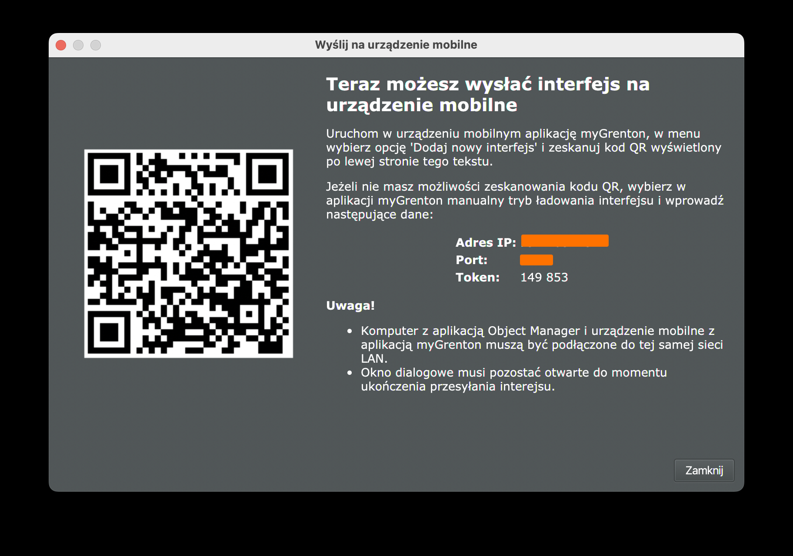

# Grenton Core for Go

Control a Grenton smart home from Go on Linux, macOS and Windows: lights,
shutters, thermostats, scenes and sensors, over the local network, the way
the myGrenton app does.

**Documentation:** <https://osieckiadam.github.io/grenton-core-go/> —
installation and a Getting Started walkthrough. The API reference is on
[pkg.go.dev](https://pkg.go.dev/github.com/osieckiAdam/grenton-core-go).

| | |
|---|---|
| **Local, no cloud** | Talks to the CLU controllers directly on your network, with their own encryption. |
| **Every device** | Switches, dimmers, RGB lights, shutters, thermostats, scenes, sensors, cameras, schedules and TV remotes. |
| **Always current** | CLUs push every change, so state stays up to date without polling. |
| **Conformance-tested** | Implements the Grenton Core specification and passes its conformance suite. |
| **Standard library only** | No dependencies beyond Go itself. |

This repository is the Go implementation of **Grenton Core**, a portable
library for the Grenton smart-home "mobile interface" protocol. The
specification is language-agnostic and lives in
[grenton-core-spec](https://github.com/osieckiAdam/grenton-core-spec),
together with the conformance suite every port must pass. It covers
provisioning (an Object Manager client and the project-file import), the
encrypted UDP runtime for CLU controllers and a canonical device model.

## Documents

- [Documentation site](https://osieckiadam.github.io/grenton-core-go/): the landing page and Getting Started, published from `main`.
- [API reference](https://pkg.go.dev/github.com/osieckiAdam/grenton-core-go) on pkg.go.dev, from the doc comments.
- [grenton-core-spec](https://github.com/osieckiAdam/grenton-core-spec): the language-agnostic specification and conformance suite. It is vendored at `vendor/grenton-core-spec` as a git submodule.
- [`docs/grenton-core-go-port.md`](docs/grenton-core-go-port.md): the Go port plan, maintainers' notes.

## Use it in your program

```sh
go get github.com/osieckiAdam/grenton-core-go@v0.15.0
```

```go
package main

import (
	"context"
	"fmt"
	"log"

	"github.com/osieckiAdam/grenton-core-go"
	"github.com/osieckiAdam/grenton-core-go/devices"
)

func main() {
	// Object Manager shows the address and the PIN in "Send to mobile devices".
	sys, err := grenton.FromObjectManager(context.Background(), "192.168.1.50", "149 853", devices.SystemConfig{})
	if err != nil {
		log.Fatal(err)
	}
	sys.Start()
	defer sys.Stop()

	for _, d := range sys.Devices() {
		fmt.Println(d.Kind, d.Name)
	}
	if lamp, ok := sys.Entity("k3Xq9TzA_0").(*devices.Switch); ok {
		on, known := lamp.IsOn()
		fmt.Println("on:", on, "known:", known)
		updates, cancel := lamp.Updates() // a flag: read the getters when it fires
		defer cancel()
		<-updates
		fmt.Println(lamp.IsOn())
	}
}
```

The PIN is the token Object Manager shows in its "Send to mobile devices"
window; Object Manager serves the interface only while that window is
open. Without Object Manager, import the project file instead:
`grenton.FromProject(data, "", cfg)`. A saved interface archive starts a
system with `grenton.FromArchive(data, cfg)`, no PIN needed. The interface
archive and the project file hold the installation's key: keep a saved
copy private.

`Session.Stop` and `System.Stop` end every socket, timer and goroutine; a
session dropped without `Stop` is closed by the garbage collector, but
call `Stop`.

## Quick start: try it against your installation

You need Go 1.26 or newer, on a computer on the same LAN as the CLUs, and
a computer running Grenton Object Manager for the first step.

```sh
git clone https://github.com/osieckiAdam/grenton-core-go.git
cd grenton-core-go
```

**1. Download the interface from Object Manager.** You need its IP address
and the PIN; see [Where to get the PIN and IP address](#where-to-get-the-pin-and-ip-address) below.

```sh
go run ./examples/fetch-interface 192.168.1.50 dist/interface.zip 149 853
```

There is no separate build step: `go run` compiles the example and starts
it. The library has no dependencies, so nothing is downloaded.

The saved file lets every next step run without a PIN. It contains the CLU
encryption key, so it is written readable by you only and `dist/` is
git-ignored.

No PIN at hand? The project file you save in Object Manager (`.omp`) holds
the same interface and key; `go run ./examples/import-project house.omp`
reads it and lists the devices. The other examples take the downloaded
archive.

**2. List your devices.** This works offline, from the saved file alone.

```sh
go run ./examples/list-devices dist/interface.zip
```

```text
switch "Living room ceiling" — page SALON
  k3Xq9TzA_0: Living room ceiling
```

`k3Xq9TzA_0` is the entity id the next steps take. At the end you also see
the CLU objects shown by several widgets, such as a thermostat that appears
on two pages under two names.

**3. Watch the live state.** This is read-only.

```sh
go run ./examples/watch-state dist/interface.zip 30
```

It connects to the CLUs, prints every entity's current state, and then prints
each change for 30 seconds. Switch a light in the house to see one arrive.

On macOS, run it from Terminal.app; see [Local network](#local-network) if
no CLU answers.

**4. Turn a light on and off.** This changes your house.

```sh
go run ./examples/switch-light dist/interface.zip k3Xq9TzA_0 on
go run ./examples/switch-light dist/interface.zip k3Xq9TzA_0 off
```

It works for switches, dimmers and RGB lights, and waits for the CLU to
confirm the new state.

### Where to get the PIN and IP address

Object Manager shows both in one dialog, the one it opens when you send the
interface to a mobile device:

1. Open your project in Object Manager.
2. In the tree on the left, select the **mobile interface** (*Interfejs mobilny*).
3. Click **Send to mobile devices** (*Wyślij na urządzenia mobilne*).
4. Read three fields from the dialog, top to bottom:
   - **IP address** (*Adres IP*): the address of the computer running Object
     Manager. It is the first argument of `fetch-interface`.
   - **Port**: usually `9998`.
   - **Token**: the PIN. It is the last argument.



The screenshot hides the IP address and port; your dialog shows them in the
same place, above the token.

- **Type the PIN as the dialog shows it.** `149 853` and `149853` both work.
  The PIN is the last argument, so the space needs no quotes.
- **If the port is not `9998`**, append it to the IP address:
  `go run ./examples/fetch-interface 192.168.1.50:9999 dist/interface.zip 149 853`.
- **Keep the dialog open** until `fetch-interface` prints `saved to …`.
  Object Manager serves the interface only while this window is open (the
  dialog itself says so).

## Examples

[`examples/`](examples/) holds small programs that use the library the way
an application would, through the public API only. Each one is a single
`main.go` meant to be read.

| Example | What it shows | Changes your house? |
|---|---|---|
| [`fetch-interface`](examples/fetch-interface/main.go) | Download the interface from Object Manager with the PIN and save it | no |
| [`import-project`](examples/import-project/main.go) | Read the interface from an Object Manager project file (`.omp`) instead of downloading it, and list the devices | no (offline) |
| [`list-devices`](examples/list-devices/main.go) | Devices and entities per page, skipped widgets, objects shown by several widgets | no (offline) |
| [`watch-state`](examples/watch-state/main.go) | Every entity's normalized state after connecting, then changes as they happen | no |
| [`switch-light`](examples/switch-light/main.go) | Turn a switch, dimmer or RGB light on/off and wait for the CLU to confirm | **yes** |
| [`run-scene`](examples/run-scene/main.go) | Run a scene by its name or entity id | **yes** |
| [`set-thermostat`](examples/set-thermostat/main.go) | Find a thermostat by its CLU object, read its state, set the target temperature and confirm the CLU applied it | **yes** |

```sh
go run ./examples/set-thermostat dist/interface.zip THE1001 21
```

`set-thermostat` reads the current target first, writes nothing if it
cannot, and prints the command that restores the previous value. Object
names such as `THE1001` (yours will differ) are in the output of `list-devices`.

## Packages

| Package | Spec module | |
|---|---|---|
| `grenton` | helper (§2) | get an interface and make its `System` |
| `model` | Model (§3) | values, references, interface DTOs |
| `provisioning` | Provisioning (§4) | Object Manager client, archives, `.omp` import |
| `clu` | Runtime (§5) | `Session` (one CLU), `Store`, cipher, UDP transport |
| `devices` | Devices (§6) | descriptors, bound entities, `System` (all CLUs) |

The reference of every package is on
[pkg.go.dev](https://pkg.go.dev/github.com/osieckiAdam/grenton-core-go).

## Requirements

Go 1.26 or newer. Linux, macOS and Windows; standard library only.

## Local network

- **macOS**: local-network privacy silently denies UDP to the LAN for
  binaries started from an IDE or an agent's shell (`no route to host`,
  `network is down`, while HTTP to the same host works). Run from
  Terminal.app, or grant the IDE access in System Settings → Privacy &
  Security → Local Network.
- **Linux, Windows**: no prompt; the firewall must allow inbound UDP on
  the ephemeral port the session binds (Windows asks on first run).
- A CLU with several network interfaces may report from another address:
  use `clu.UDP{AnySource: true}` as the transport
  (`go run ./examples/watch-state -any-source …` in the examples).

## Versioning and stability

Releases are tagged with the version of the specification they implement:
`v0.15.0` implements spec 0.15.0 and passes suite 0.15.0. Until 1.0 the
module promises conformance with the spec, not a frozen API. Every change
is listed in [`CHANGELOG.md`](CHANGELOG.md).

## Conformance

Suite 0.15.0, all six profiles (`stateless`, `mapping`, `project`,
`session`, `provisioning`, `entities`), 391 cases, no skips
(`conformance/port.json`). The session scenarios run with an exact idle
barrier, 20 times under the race detector in the gate.

## Running the tests

The conformance tests read the suite from the `vendor/grenton-core-spec`
submodule, so fetch it first:

```sh
git submodule update --init   # or clone with --recurse-submodules
go test ./...
```

The `conformance` package runs every case of the
[conformance suite](https://github.com/osieckiAdam/grenton-core-spec/blob/main/spec/conformance.md).
It fails if the submodule is missing, if the manifest is inconsistent, or
if a case fails. The `session` scenarios drive a real `clu.Session`
through a scripted transport and a virtual clock, so they need no network
and no CLU.

`scripts/check.sh` is the full gate (also the pre-push hook): formatting,
vet, the tests under the race detector, the examples, the documentation
site's links and its Go snippets. Enable the hooks once per clone with
`git config core.hooksPath scripts/hooks`. See `CLAUDE.md` and
`docs/grenton-core-go-port.md`.

## License

[MIT](LICENSE). The specification and its conformance suite
([grenton-core-spec](https://github.com/osieckiAdam/grenton-core-spec)) are
MIT as well.
